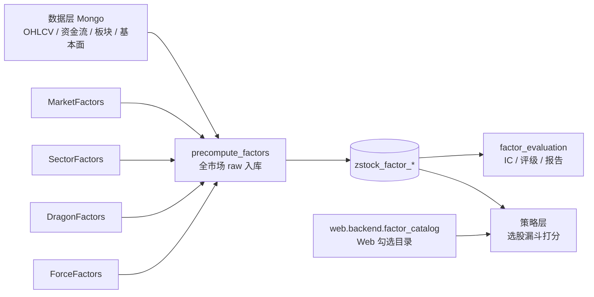
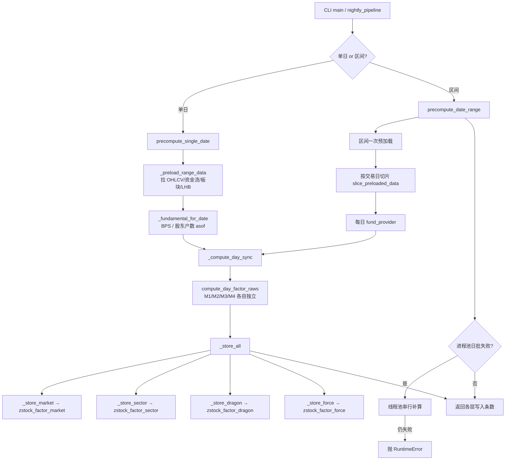
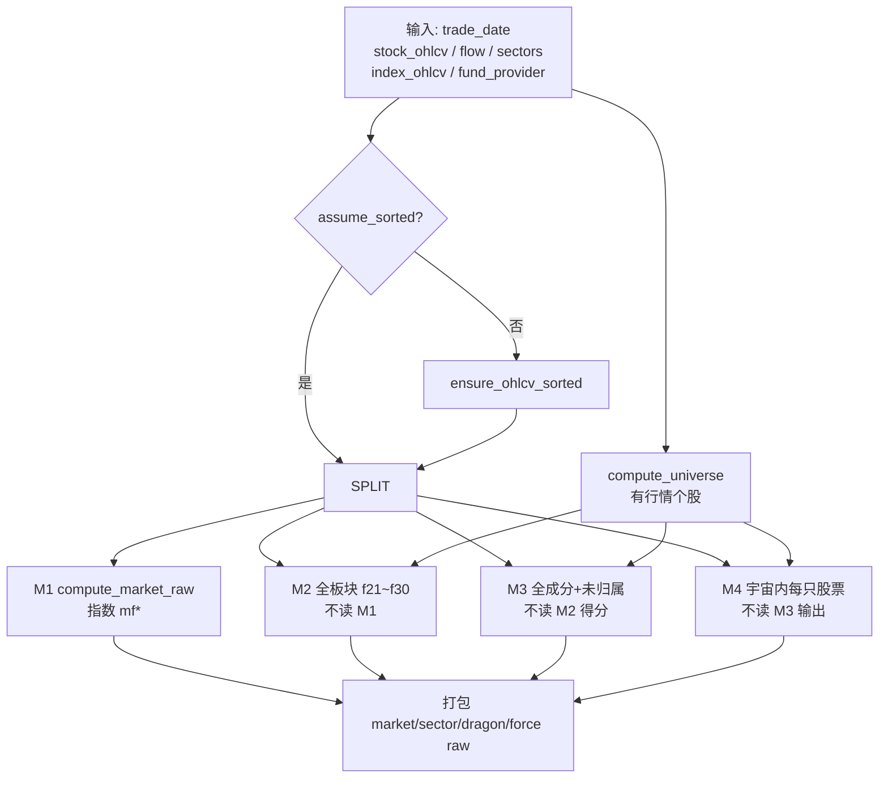
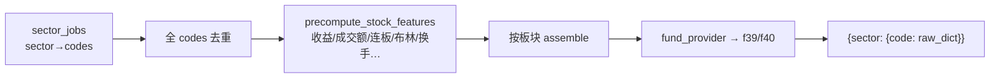
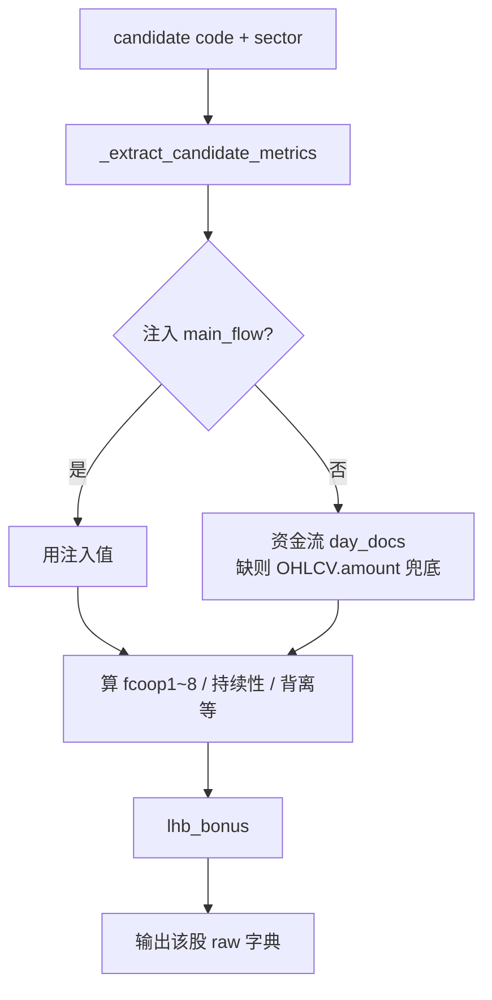
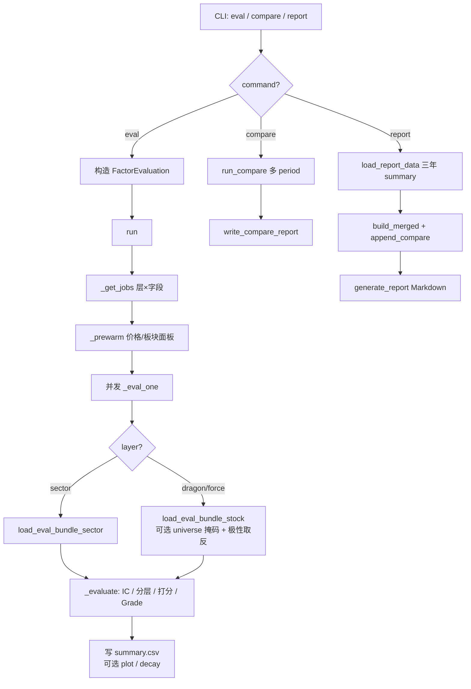
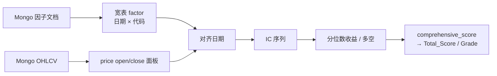
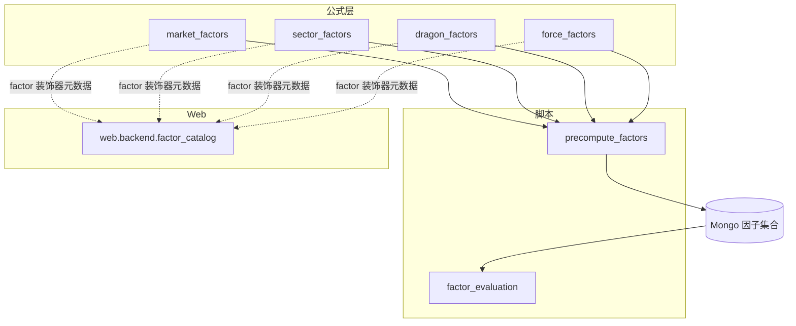

# Factor Management 模块（研究层 / 第 2 层）

## 概述

`factor_management` 是量化交易系统的研究层，负责因子公式、因子目录与预计算入库。  
各层（M1~M4）按定义**独立**计算 raw；「板块过滤 → 龙头 → 合力」漏斗只存在于策略层。

系统分层位置：

```text
第 0 层：治理与监控层
        ↓
第 1 层：数据层（data_management）
        ↓
第 2 层：研究层（factor_management）  <- 当前模块
        ↓
第 3 层：策略层（strategy_management）
        ↓
第 4 层：执行层（order_management）
```

```text
market_factors.py   M1 市场层
sector_factors.py   M2 板块层
dragon_factors.py   M3 龙头层
force_factors.py    M4 合力层
script/precompute_factors.py   全市场预计算入库
script/factor_evaluation.py    因子有效性测评 / 报告
```

宇宙准入过滤见 `zstock.common.prefilters.PreFilters`；选股漏斗见 `strategy_management`。

---

## 流程图

### 总览：因子层在系统中的位置



### 细节 1：预计算管道 `FactorPrecomputeService`



### 细节 2：单日截面 `compute_day_factor_raws`（四层独立，无漏斗）

层间**不做**「M2 过滤 → M3 → M4」；那是策略层 `signal_funnel` 的事。这里同一 `compute_universe` 只作输入范围，各层按定义全算。



### 细节 3：M3 龙头批处理内部



### 细节 4：M4 合力单候选



### 细节 5：因子测评 `FactorEvaluation`



### 细节 6：测评单因子 `_eval_one` 数据流



模块协作关系：



---

## 公有方法一览

以下仅列**公有方法**（不含 `_` 前缀内部实现）。


### 1. `MarketFactors`（M1）

| 方法 | 作用 |
|------|------|
| `min_bars` | 指数最少 K 线根数要求 |
| `compute_market_raw` | 指数 OHLCV → `trend_gap`；数据不足时返回 `reason` |
| `trend_gap` | 收盘 / MA120 − 1 |
| `rank_autocorr` | 滚动收益排名的 1 阶 Spearman 自相关（风格特征） |

### 2. `SectorFactors`（M2）

| 方法 | 作用 |
|------|------|
| `aggregate_sector_ohlcv` | 成分股行情/资金流聚合为板块日线 OHLCV 与资金流 |
| `calculate_all_sector_factors_raw` | 批量计算 M2 全部子因子原始值 `{field: {sector: value}}` |
| `raw_from_docs` | 预计算板块文档 → `{field: {sector_code: value}}` |
| `f21_rps` | 板块窗口收益的截面平均秩百分位 0~100 |
| `f22_main_flow` | 板块主力净流入合计 |
| `f23_limit_up_density` | 涨停家数 / 成分数 |
| `f24_max_consecutive` | 板块内最大连板高度 |
| `f25_volume_slope` | 成交额占比 MA 近窗线性斜率（多窗口） |
| `f26_volume_growth` | 短均量 / 长均量 − 1 |
| `f27_new_high_ratio` | 创 N 日新高家数 / 成分数 |
| `f28_consistency` | 近 N 日排名 Top10% 天数（全市场板块排名） |
| `f29_sector_breadth` | 当日上涨家数 / 成分数 |
| `f30_sector_concentration` | Top3 成交额 / 板块总成交额 |

### 3. `DragonFactors`（M3）

| 方法 | 作用 |
|------|------|
| `calculate_all_dragon_factors_in_sector_raw` | 单板块龙头因子 raw `{code: raw_dict}` |
| `calculate_all_dragon_factors_raw` | 多板块：个股特征算一次再按板块组装 |
| `raw_from_doc` | 预计算龙头文档 → 单股 raw 字段字典 |
| `precompute_stock_features` | 个股级 M3 特征（与板块无关，供多板块复用） |
| `assemble_sector_raw_from_features` | 用预计算特征组装某板块成分股 raw |
| `apply_fundamental_factors` | 写入 f39_pb / f40_holder_change（依赖 fund_provider） |
| `sorted_ohlcv_map` | OHLCV 按日升序整理（可选 asof 截断） |
| `nd_returns` | 从 OHLCV 算 N 日收益率 |
| `daily_volumes` | 当日成交额（优先 amount） |
| `turnover_rates` | 当日换手率 |
| `f31_excess_return` | 个股收益 − 板块中位数 |
| `f31b_rps_percentile` | 个股收益在板块内百分位 0~100 |
| `f32_amount` | 当日成交额 |
| `f33_consecutive_boards` | 最近连续涨停天数 |
| `f34_resonance_pct` | 多窗口量价共振健康日占比 |
| `f35_bollinger_trend` | 布林趋势分 + pass 标志（一次算完） |
| `f36_identity_premium` | 个股换手 / 板块均值（无换手则用成交额比） |
| `f37_relative_strength` | 板块内收益 z-score |
| `f38_turnover_anomaly` | 当日换手 / 20 日均值 |
| `f39_pb` | 收盘价 / BPS |
| `f40_holder_change` | 股东户数相对变化 |

### 4. `ForceFactors`（M4）

| 方法 | 作用 |
|------|------|
| `apply_cooperative_force_raw` | 候选列表 → 合力子因子 raw（含多窗口与龙虎榜加分） |
| `fcoop1_main_net_ratio` | 主力净流入 / 成交额，流出为负 |
| `fcoop2_main_retail_ratio` | 主力 / (主力+\|散户\|) |
| `fcoop3_sustained_days` | 近 window 日主力净流入 > 0 的天数 |
| `fcoop4_turnover_quality` | 换手率质量分 |
| `fcoop5_main_flow_acceleration` | 主力净流入加速度 |
| `fcoop6_main_force_aggression` | 主力进攻性 |
| `fcoop7_super_large_net_ratio` | 超大单净流入占比 |
| `fcoop8_main_flow_trend_5d` | 近 5 日主力净流入趋势 |
| `limit_down_free_days` | 近 5 日未跌停天数 |
| `f_power_divergence` | 量价背离度 |
| `f_main_force_persistence` | 主力持续性 |
| `f_mean_reversion_signal` | 均值回归信号 |
| `sigmoid` | Sigmoid 映射工具 |
| `lhb_bonus` | 龙虎榜加分（机构/游资等） |

### 5. `script.precompute_factors`

#### 当日 raw 打包（脚本内，非策略编排）

| 方法 | 作用 |
|------|------|
| `compute_day_factor_raws` | 同一日对 M1~M4 **各自独立**算 raw 并打包；层间无过滤 |

#### `FactorPrecomputeService`

| 方法 | 作用 |
|------|------|
| `__init__` | 绑定 QueryService，按资源预算设 compute/load/query 并发 |
| `precompute_single_date` | 单日：预加载 → `compute_day_factor_raws` → 写入 Mongo |
| `precompute_date_range` | 区间批量预计算（进程池/线程池 + 失败日补算） |
| `slice_preloaded_data` | 从预加载大表切出单日 lookback 窗口输入 |

#### 模块入口

| 方法 | 作用 |
|------|------|
| `main` | CLI：按日期区间跑 `FactorPrecomputeService` |

### 7. `script.factor_evaluation.FactorEvaluation`

| 方法 | 作用 |
|------|------|
| `__init__` | 配置测评窗口、分层数、宇宙、极性取反、并发与输出目录 |
| `load_stock_factor_panel` | 从 Mongo 拉个股因子宽表（日期×代码） |
| `load_sector_factor_panel` | 从 Mongo 拉板块因子宽表 |
| `load_price_panel` | 加载个股 open/close 价格面板（带缓存） |
| `load_sector_price_panel` | 由成分股收益合成板块指数价格面板 |
| `apply_universe_mask` | 按日宇宙掩码，宇宙外置 NaN |
| `apply_polarity_invert` | 对注册表负 IC 字段取反 |
| `load_eval_bundle_stock` | 个股层：因子面板 + 价格面板打包 |
| `load_eval_bundle_sector` | 板块层：因子面板 + 板块价格打包 |
| `run` | 执行测评任务列表，写 `summary.csv`；可选进度回调 |
| `grade_letter` | Grade 字符串规范为 A/B/C/D/N/A |
| `year_eval_window` | 自然年测评起止日 |
| `run_batch_years` | 多年批量测评 |
| `run_compare` | 多口径（period）对照测评 |
| `write_compare_report` | 对照结果写 Markdown 报告 |
| `fmt_cell` / `fmt_ric` | 报告单元格 / RankIC 格式化 |
| `load_report_data` | 读三年 summary.csv |
| `build_merged` | 三年因子 key 对齐合并表 |
| `load_compare_summaries` | 扫描对照目录下的 summary 路径 |
| `build_compare_detail` | 历史 A 因子对照明细表 |
| `append_compare_sections` | 向主报告追加多口径对照章节 |
| `generate_report` | 生成 2024/2025/2026 对比报告 Markdown |
| `build_parser` | CLI 参数（eval / compare / report） |
| `async_main` | 异步 CLI 主流程 |
| `main` | 同步入口（`asyncio.run`） |

模块级别名：`build_parser` / `async_main` / `main` → 转调类方法。
