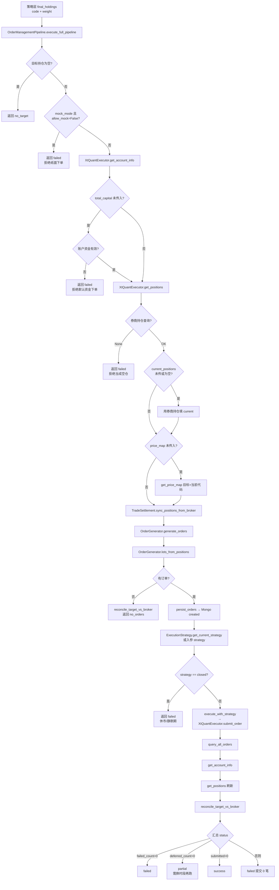
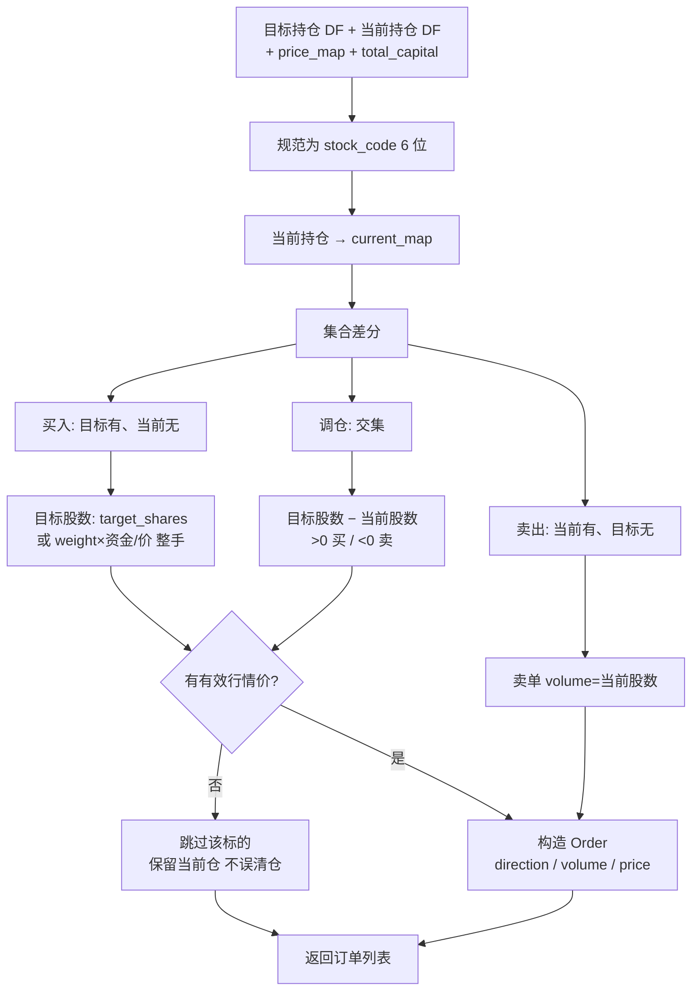
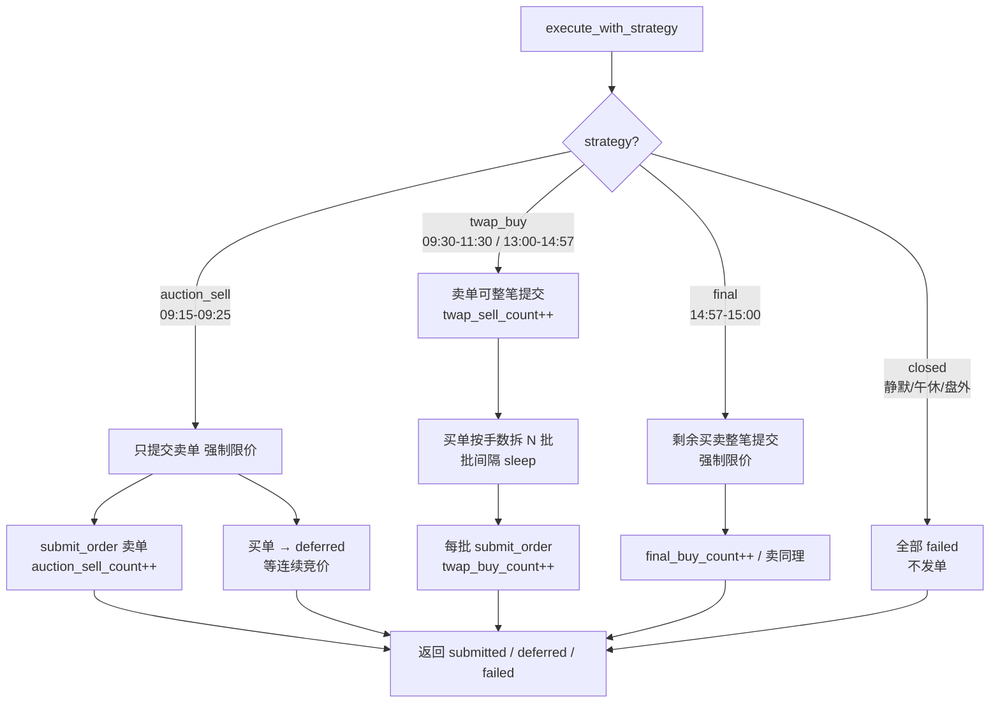
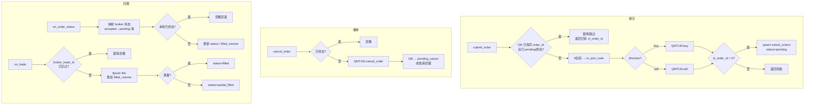
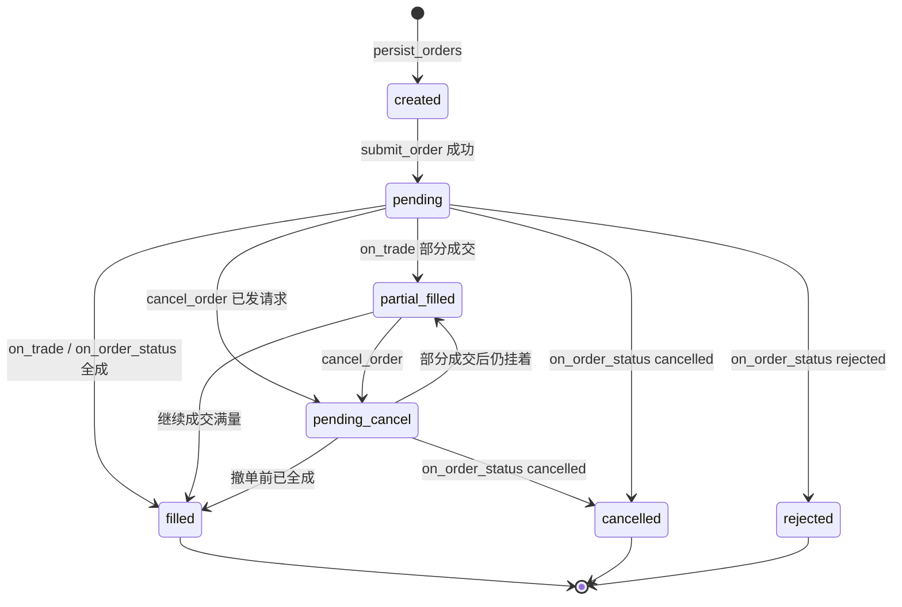
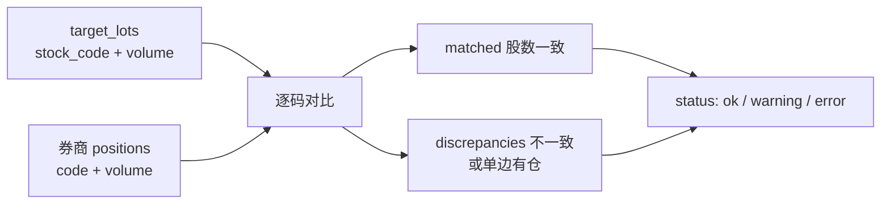
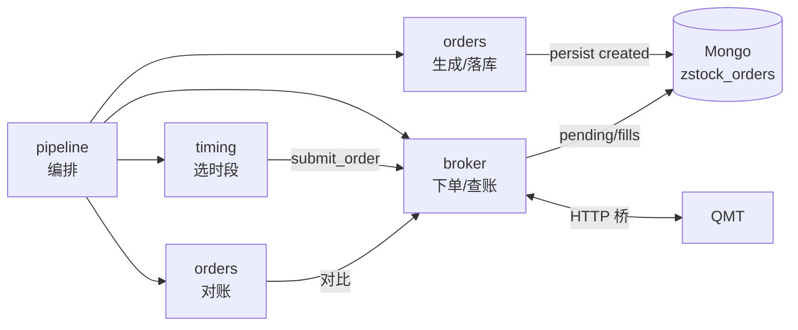

# Order Management 模块（执行层 / 第 4 层）

## 概述

`order_management` 是量化交易系统的执行层：目标持仓 → 订单 → 按时段提交 QMT → 对账。

系统分层位置：

```text
第 0 层：治理与监控层
        ↓
第 1 层：数据层（data_management）
        ↓
第 2 层：研究层（factor_management）
        ↓
第 3 层：策略层（strategy_management）
        ↓
第 4 层：执行层（order_management）  <- 当前模块
```

```text
orders.py     订单生成与成交对账
broker.py     QMT 桥客户端与下单 / 回报
timing.py     集合竞价 / TWAP / 尾盘时段策略
intraday.py   盘中回撤卖出、14:00 重挂、14:50 撤单和尾盘买回
pipeline.py   流程编排
```

日内阈值在 `strategy_params.json` 的 `intraday_risk`。`default` 是全部股票的统一参数。行业 ETF、国债、黄金在 `codes` 里按代码各写一行，例如 `518880`。表里没有的代码用 `default`。09:30 仍由策略层给出目标持仓，再交给 `IntradayBook.note_targets` 和 `on_open`。之后每 5 分钟调用 `tick`。

典型串联：

```text
StrategyPipeline → final_holdings (code + weight)
                → OrderManagementPipeline.execute_full_pipeline(...)
```

工作流：订单生成 → 按时段执行 → XtQuant 提交 → 目标股数 vs 券商持仓对账。

订单集合：`zstock_orders`（`created` → `pending` → `filled` / `partial_filled` / `cancelled` / `rejected`）。

---

## 流程图

### 总览：`execute_full_pipeline`



### 细节 1：订单生成 `OrderGenerator.generate_orders`



### 细节 2：时段策略 `ExecutionStrategy`



### 细节 3：券商下单与回报 `XtQuantExecutor`



### 细节 4：订单状态机（`zstock_orders`）



### 细节 5：对账 `TradeSettlement.reconcile_target_vs_broker`



模块协作关系：



---

## 公有方法一览

### 1. `OrderGenerator`（`orders.py`）

| 方法 | 作用 |
|------|------|
| `__init__` | 初始化内存订单簿与序号 |
| `generate_orders` | 目标/当前持仓 → 买卖/调仓订单列表；缺行情跳过该标的，不误清仓 |
| `lots_from_positions` | 目标持仓 → `stock_code` + `volume`（股）；换算失败的标的省略 |
| `persist_orders` | 订单幂等落库为 `created`（`$setOnInsert`，不覆盖已有文档） |

### 2. `TradeSettlement`（`orders.py`）

| 方法 | 作用 |
|------|------|
| `__init__` | 初始化成交记录与本地持仓账本 |
| `sync_positions_from_broker` | 用券商持仓覆盖本地账本（对账前） |
| `reconcile_target_vs_broker` | 目标股数 vs 券商实际持仓对账，返回 matched / discrepancies |

### 3. `QMTClientFactory` / `QMTConnectionError`（`broker.py`）

| 方法 / 类型 | 作用 |
|------|------|
| `QMTConnectionError` | HTTP 桥不可用时抛出的异常 |
| `QMTClientFactory.create` | 创建并连接 QMT 桥客户端；连不上抛 `QMTConnectionError` |

### 4. `XtQuantExecutor`（`broker.py`）

| 方法 | 作用 |
|------|------|
| `__init__` | 绑定 `QMTUtil`（可注入）；`allow_mock` 控制是否允许纸面客户端 |
| `submit_order` | 提交买卖单并写/更新 `zstock_orders`；同 `order_id` 幂等不重发 |
| `query_order` | 按 `order_id` 查库中订单文档 |
| `query_all_orders` | 查全部订单（可按 status 过滤） |
| `cancel_order` | 发撤单请求，状态置 `pending_cancel`（终态由回报推进） |
| `on_order_status` | 券商订单状态回报 → 更新 DB（终态不可回退） |
| `on_trade` | 券商成交回报 → 记 fills、累加成交量并推进 partial/filled（按 `broker_trade_id` 幂等） |
| `get_account_info` | 现金 / 总资产 / 冻结资金 |
| `get_positions` | 券商持仓列表（6 位 code）；查询失败返回 `None` |
| `get_price_map` | 批量最新价 `{code: price}` |
| `is_connected` | QMT 连接是否活跃 |

### 5. `ExecutionStrategy`（`timing.py`）

| 方法 | 作用 |
|------|------|
| `__init__` | 配置 TWAP 批次数与批间隔 |
| `get_current_strategy` | 按 Asia/Shanghai 时段返回 `auction_sell` / `twap_buy` / `final` / `closed` |
| `execute_with_strategy` | 按策略提交订单；返回 `submitted` / `deferred` / `failed` 计数 |

时段要点：

| 时段 | 策略 |
|------|------|
| 09:15–09:25 | `auction_sell`（仅限价卖；买单 deferred） |
| 09:25–09:30 / 午休 / 盘外 | `closed` |
| 09:30–11:30、13:00–14:57 | `twap_buy`（连续竞价分批） |
| 14:57–15:00 | `final`（收盘集合竞价，仅限价） |

### 6. `OrderManagementPipeline`（`pipeline.py`）

| 方法 | 作用 |
|------|------|
| `__init__` | 组装 OrderGenerator / XtQuantExecutor / TradeSettlement / ExecutionStrategy |
| `execute_full_pipeline` | 完整管道：补行情/持仓/资金 → 生成订单 → 时段执行 → 落库 → 对账；返回摘要 Dict |

导出见包 `__init__`：`OrderGenerator`、`TradeSettlement`、`XtQuantExecutor`、`QMTClientFactory`、`QMTConnectionError`、`ExecutionStrategy`、`OrderManagementPipeline`。
