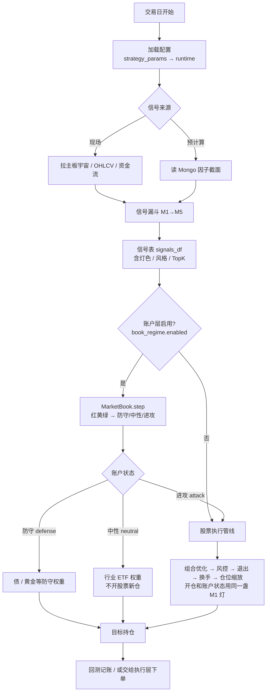
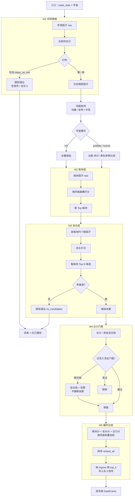
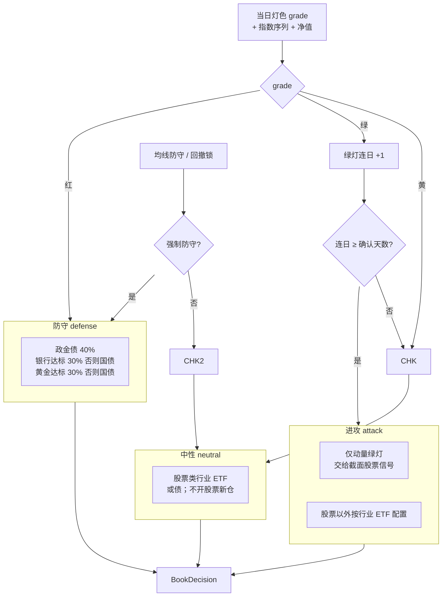
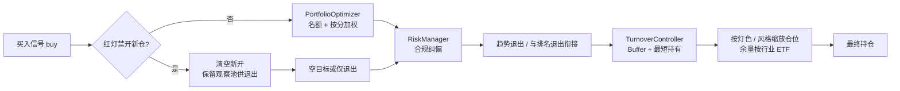
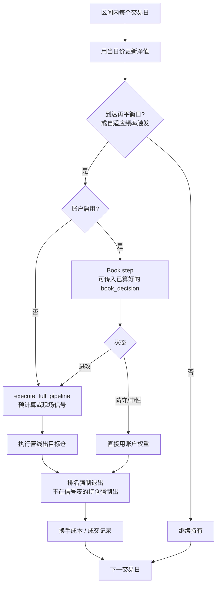
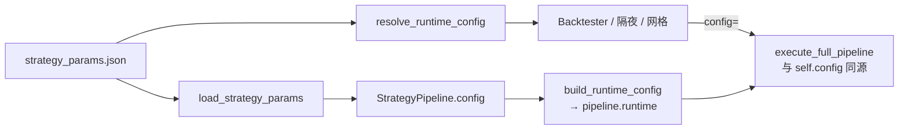

# strategy_management（策略层 / 第 3 层）

## 概述

`strategy_management` 是量化交易系统的**策略层**：消费因子层 raw，产出买卖信号与目标持仓，再交给执行层下单。

系统分层：

```text
第 0 层：治理与监控层
        ↓
第 1 层：数据层（data_management）
        ↓
第 2 层：研究层（factor_management）—— 因子公式 / 预计算
        ↓
第 3 层：策略层（strategy_management）  ← 当前模块
        ↓
第 4 层：执行层（order_management）
```

配置单一真实源（SSOT）：`zstock/common/config/strategy_params.json`，经 `strategy_config.resolve_runtime_config` 派生运行态；信号与执行共用同一份参数，禁止旁路硬编码。

---

## 模块与类职责

### 编排入口

| 类 / 模块 | 作用 |
|---|---|
| **StrategyPipeline** | 策略总编排：取数 → 情绪+选股漏斗 → 红黄绿账户 → 组合/风控/换手。持有 `config`（原始 JSON）与 `runtime`（执行态）。 |
| **SignalFunnelMixin** | 挂在 Pipeline 上的信号漏斗：M1→M5 共用编排（现场算因子 / 读预计算文档走同一套打分与门禁）。 |

### 领域：情绪 · 选股 · 账户

| 类 / 模块 | 作用 |
|---|---|
| **sentiment** | 市场情绪：由市场因子算红/黄/绿、仓位缩放；`detect_style` 判动量/反转/中性。 |
| **selection** | 截面选股：板块打分(M2)、龙头打分(M3)、合力门禁(M4)、最终加权合成(M5)。 |
| **MarketBook** | 跨日账户状态机：红→防守、黄→中性、动量绿灯确认后→进攻；中性或反转绿灯留在行业 ETF。 |
| **BookDecision** | 单日账户决策：`state` / `weights` / `grade`。 |
| **BookMarketInputs** | 账户判定用的指数与资产收盘序列（截至上一交易日）。 |

### 组合执行

| 类 / 模块 | 作用 |
|---|---|
| **execution** | 进攻日股票执行管线：组合优化 → 风控 → 趋势/排名退出衔接 → 换手 → 仓位缩放；防守/中性日直接落账户权重。 |
| **PortfolioOptimizer** | 按 `final_score` 在持仓名额内分配权重（等权 / 分数 / softmax），单股上限后再归一化。 |
| **RiskManager** | 持仓合规检查与纠偏：权重和、单股上限、集中度、持仓数、行业暴露。 |
| **TurnoverController** | Buffer 换手 + 最短持有 + 成本估算，抑制无意义调仓。 |
| **exit_policy** | 退出规则：排名分位强制出、趋势/布林弱势退出（供回测日与执行层调用）。 |

### 信号契约与宇宙

| 类 / 模块 | 作用 |
|---|---|
| **signal_schema** | 信号 DataFrame 列约定、空表、候选去重与结果转表。 |
| **universe_builder** | 按日构建测评/隔夜宇宙：`full` / `prefilter` / `funnel`（漏斗按日算 M3，与实盘一致）。 |

### 脚本（回测 / 网格 / 隔夜）

| 类 / 模块 | 作用 |
|---|---|
| **Backtester** | 日频再平衡回测：拉 OHLCV、调 Pipeline、记账净值与换手。 |
| **BacktestResult** | 回测结果：净值曲线、回撤、成交、持仓日志、指标与导出。 |
| **RealGridSearchOptimizer** | 预计算路径上的参数网格搜索，整包 `strategy_params` 派生，无旁路 runtime。 |
| **overnight_backtest** | 隔夜批跑：预检、备份参数、多区间回测/敏感度/网格、报告。 |
| **run_style_detector** | 单独跑风格检测，便于诊断。 |

---

## 完整策略流程

### 1. 总览（单日）



> **信号灯**：M1 只算一次。账户状态（防守/中性/进攻）和仓位缩放都读这盏灯。风格（动量/反转/中性）不是灯。


### 2. 信号漏斗（M1 → M5）

现场与预计算共用同一套打分；仅 raw 来源不同。



### 3. 红黄绿账户（MarketBook）

判定用**截至上一交易日**的指数与资产收盘；目标权重加总为 1。行业仓波动高于 `vol_target` 时缩到目标，缩掉的部分买国债。进攻日股票以外的权重按同一套行业配置填充。



### 4. 进攻日股票执行（execution）



### 5. 回测日循环（Backtester）



### 6. 配置流（SSOT，无双轨）



---

## 关键文件索引

| 路径 | 说明 |
|---|---|
| `pipeline.py` | StrategyPipeline |
| `signal_funnel.py` | SignalFunnelMixin（M1–M5） |
| `sentiment.py` | 情绪与风格 |
| `selection.py` | 板块 / 龙头 / 合力 / 合成 |
| `market_book.py` | MarketBook / BookDecision |
| `execution.py` | 进攻日执行阶段 |
| `exit_policy.py` | 排名与趋势退出 |
| `portfolio_optimizer.py` | 组合权重 |
| `risk_manager.py` | 风控 |
| `turnover_controller.py` | 换手 |
| `signal_schema.py` | 信号表契约 |
| `universe_builder.py` | 按日宇宙 |
| `script/backtester.py` | 回测器 |
| `script/grid_search_real.py` | 网格搜索 |
| `script/overnight_backtest.py` | 隔夜批跑 |

因子公式与预计算落库在 `factor_management`；本包**只消费 raw**，不重复定义因子。
